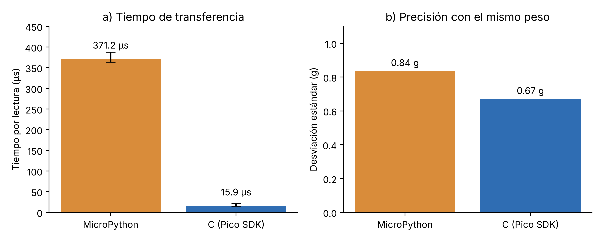
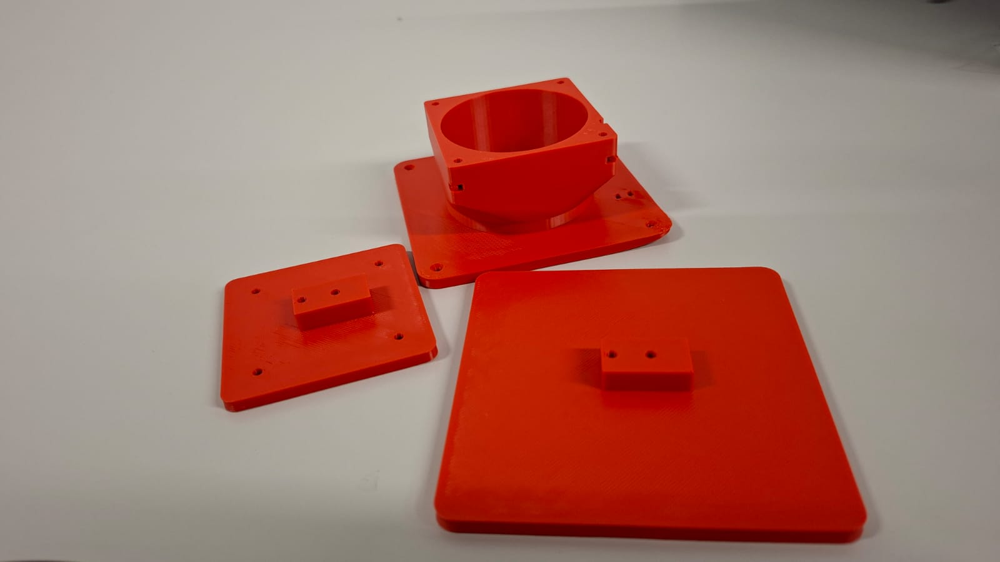

# README

## ¿De qué trata este proyecto?

Secar café en casa parece sencillo, pero saber cuándo está listo no lo es. Quien lo hace por afición casi nunca tiene un medidor de humedad y termina decidiendo "a ojo". Si retira el grano antes de tiempo, puede aparecer moho mientras lo guarda. Si lo deja de más, el grano se seca en exceso y pierde calidad.

Queríamos ayudar a resolver eso con lo que aprendimos en el curso. Por eso construimos un **secador solar de café instrumentado**: un sistema que pesa el café, mide cómo está el aire dentro del secador, enciende un extractor cuando hace falta sacar la humedad y avisa al celular cuando el grano llega a su punto.

Este es nuestro proyecto final de **Arquitectura del Computador I** (código 16953) en la Universidad ESAN, semestre 2026-2, con el profesor Marks Calderón Niquin. Corresponde al **Proyecto N° 7** de la guía del curso.

## ¿Para quién es?

Pensamos en el **aficionado al café** que seca lotes pequeños en casa y quiere hacerlo bien. Nuestro prototipo trabaja con hasta 5 kg, justo la escala de un aficionado. La idea es que pueda revisar desde el celular cómo va su café, recibir un aviso cuando esté listo y guardar la curva de cada secado para compararlas.

## ¿Cómo funciona?

La idea central es sencilla: **cuando el café se seca, solo pierde agua**. Si pesamos la muestra al inicio y la seguimos pesando, sabemos cuánta agua ha perdido y, con eso, qué tan seco está.

```
 SHT31 (aire del secador) ────┐
                              ├──> Raspberry Pi Pico 2 W ──Wi-Fi──> Adafruit IO
 Celda de carga + HX711 ──────┘            │                       (dashboard y alertas)
                                           │ PWM
                                           v
                                 MOSFET ──> Extractor 12 V
```

Paso a paso:

1. Ponemos una muestra de café en una **bandeja** que descansa sobre una **celda de carga**, y el sistema la pesa continuamente.
2. Un sensor **SHT31** mide la temperatura y la humedad del aire dentro del secador.
3. La **Raspberry Pi Pico 2 W** junta esa información, estima la humedad del grano y decide a qué velocidad debe girar el **extractor**.
4. Todo se envía a **Adafruit IO**, donde se ve la curva de secado en tiempo real.
5. Cuando el grano llega al peso que buscamos, llega el aviso: *el café está listo*.

### La cuenta detrás del aviso

Si sabemos cuánto pesaba la muestra al principio (`W0`) y qué humedad tenía (`H0`), podemos calcular cuánto debe pesar cuando llegue a la humedad final que queremos (`Hf`):

```
W_objetivo = W0 × (1 − H0) / (1 − Hf)
```

Según la [guía de secado de café de Perfect Daily Grind (Castellano, 2020)](https://perfectdailygrind.com/es/2020/11/30/guia-para-el-secado-de-cafe/), antes de secarse el café tiene entre 40 % y 50 % de humedad, y el objetivo es bajarla a 11–12 %. La misma guía recomienda no pasar de 40 °C al secar café en pergamino, así que ese es el límite de nuestra alerta de temperatura.

Por ejemplo, si ponemos 1000 g de café con 45 % de humedad y queremos llegar a 12 %, el aviso llega cuando la muestra pesa unos **625 g**.

## ¿Con qué lo construimos?

El cerebro del sistema es una **Raspberry Pi Pico 2 W**, que tiene Wi-Fi integrado. A ella se conectan:

- **SHT31**, para medir la temperatura y la humedad del aire. Se comunica por **I2C**.
- **Celda de carga de 5 kg con el módulo HX711**, para pesar el grano. El HX711 usa su propia comunicación de dos hilos (reloj y datos).
- **Ventilador extractor de 12 V**, que controlamos con **PWM** a través de un módulo **MOSFET HW-042**. Así no solo lo prendemos y apagamos, también regulamos su velocidad.

Para la energía usamos una **fuente de 12 V y 2 A**. El extractor la usa directamente, y un **convertidor LM2596** la baja a 5 V para la Pico. Tiene un interruptor de encendido, y todas las tierras (GND) están unidas para que las señales funcionen bien.

Además usamos una protoboard para las pruebas, una placa perforada para el montaje final, resistencias, cables Dupont y un cable micro-USB.

### Conexiones

| Componente | Pin del componente | Pin de la Pico 2 W |
| --- | --- | --- |
| SHT31 | SDA / SCL | GP4 / GP5 (pines 6 / 7) |
| HX711 | DT / SCK | GP14 / GP15 (pines 19 / 20) |
| MOSFET HW-042 | Señal PWM | GP16 (pin 21, con resistencia de 220 Ω) |
| Sensores | VCC / GND | 3V3 / GND |

El diagrama de conexiones completo está en la carpeta `docs/`.

## El programa

Lo escribimos en **MicroPython** usando Thonny. Como el sistema tiene que hacer varias cosas a la vez (leer los sensores, mover el extractor, mandar datos a la nube y revisar si hay que avisar), usamos **`asyncio`** para que cada tarea corra sin bloquear a las demás. Si se cae el Wi-Fi, el sistema intenta reconectarse solo.

En el **dashboard de Adafruit IO** se puede:

- ver la curva de secado, es decir, cómo baja el peso con el tiempo;
- revisar la temperatura y la humedad dentro del secador;
- recibir un aviso cuando el café llega a su punto;
- recibir una alerta si la temperatura se sale del rango seguro;
- encender o ajustar el extractor desde el celular.

> La contraseña del Wi-Fi y la clave de Adafruit IO están en un archivo de configuración local que no subimos al repositorio.

## Nuestro reto de arquitectura

Para el reto elegimos **C/C++ con Pico SDK**. Reescribimos en C la parte que lee la balanza (el HX711) y la comparamos con la versión en MicroPython, con el mismo circuito (DT en GP14, SCK en GP15) y el mismo peso sobre la celda.

| Qué medimos | Cómo lo medimos | MicroPython | C (Pico SDK) |
| --- | --- | --- | --- |
| Tiempo por lectura (µs) | Promedio de 100 lecturas | 371.2 (mín 364, máx 388) | **15.9** (mín 15, máx 22) |
| CPU ocupada (a 10 lecturas/s) | Tiempo de lectura × 10 / 1 s | 0.371 % | **0.016 %** |
| Precisión (g) | Desviación estándar con el mismo peso | 0.84 g (31 lecturas) | **0.67 g** (100 lecturas) |
| Lecturas por segundo | Lecturas completas en 10 s | 11.7 | 11.7 |



**Qué concluimos:** en C la lectura es unas **23 veces más rápida**, porque los pulsos de reloj se generan con código compilado que escribe directo en los registros GPIO, mientras que en MicroPython cada cambio de pin pasa por el intérprete. Así queda más CPU libre para el Wi-Fi y las demás tareas. Las dos versiones tienen precisión menor a 1 g. Las lecturas por segundo son iguales porque las limita el HX711 (unas 10 por segundo), no el lenguaje.

Los datos completos están en `mediciones/` (ver `mediciones/resultados_reto_hx711.md`).

## Las piezas que imprimimos en 3D

- **Bandeja de pesaje:** la placa grande, donde va el café. Se apoya sobre la celda de carga.
- **Base de la balanza:** la placa pequeña. Sostiene la celda de carga por debajo, así que la balanza queda en tres capas: base, celda y bandeja.
- **Ducto del extractor:** la base con el aro donde va el ventilador de 8 × 8 cm. Guía la salida del aire húmedo.

Así quedaron impresas. Atrás está el ducto del extractor, a la izquierda la base de la balanza y a la derecha la bandeja de pesaje:



Los archivos están en la carpeta `cad/`. *(completar)*

## ¿Qué hay en este repositorio?

```
micropython/   El programa principal
c_sdk/         La versión en C para el reto de arquitectura
cad/           Los diseños y archivos STL de las piezas 3D
docs/          Diagrama de conexiones, fotos y el paper
```

## Si quieres probarlo

1. Instala MicroPython en la Raspberry Pi Pico 2 W.
2. Abre Thonny y copia a la Pico los archivos de la carpeta `micropython/`.
3. Crea tu archivo de configuración con tu red Wi-Fi y tu clave de Adafruit IO.
4. Calibra la balanza con un peso conocido.
5. Coloca la muestra de café, enciende el sistema y abre el dashboard.

## Lo que obtuvimos

*(Completar con las mediciones reales: precisión de los sensores, curva de secado, funcionamiento de las alertas y resultados del reto de arquitectura.)*

## Quiénes somos

- **Cesar Emanuel Dioses Santos** (26101848): responsable técnico y coordinador. Hardware, montaje, piezas 3D y reto en C/C++.
- **Salma Nazzira Moscoso Medina** (26102550): responsable de conectividad y del repositorio. Wi-Fi, MQTT, dashboard y GitHub.
- **Eduardo Matias Roncal Vivanco** (26100342): responsable de documentación. README, diagramas, mediciones, paper y presentación.
